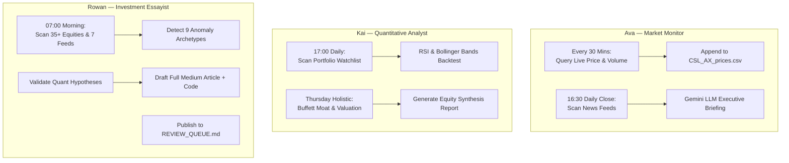

# AI Employee Suite: Autonomous Digital Workers

> **Stop building reactive AI chatbots. Build zero-touch digital workers that execute real jobs while you sleep.**

Welcome to the **AI Employee Suite**—a production-grade blueprint for autonomous, schedule-driven AI agents running headlessly at the operating system level.

Read the founding thesis and story in [**HOW_TO_BUILD_AN_AI_EMPLOYEE.md**](HOW_TO_BUILD_AN_AI_EMPLOYEE.md).

---

## 👥 Meet Your Digital Workforce



### 1. 📈 Ava: Market Monitor & Financial News Analyst
* **Role**: Tracks equities with zero human prompting.
* **Cadence**: Every 30 minutes during market trading; daily at 16:30 market close.
* **Deliverables**: Real-time structured ledger (`CSL_AX_prices.csv`), rolling activity logs, and daily Gemini-synthesized executive briefings (`csl_daily_briefing.md`).
* **Run Immediately**: Double-click `start_employee.bat` or `RUN_NEWS_BRIEFING_NOW.bat`.

### 2. 📊 Kai: Quantitative & Fundamental Portfolio Analyst
* **Role**: Evaluates portfolio watchlists against statistical and fundamental criteria.
* **Cadence**: Headless run at 17:00 weekdays; deep holistic synthesis on Thursdays.
* **Deliverables**: Backtest charts (`*_rsi.png`, `*_bb.png`), daily report (`quant_daily_report.md`), and weekly fundamental report (`weekly_holistic_equity_report.md`).
* **Run Immediately**: Double-click `RUN_QUANT_ANALYSIS_NOW.bat` or `RUN_THURSDAY_HOLISTIC_REPORT_NOW.bat`.

### 3. ✍️ Rowan: Autonomous Trading Concept Hunter & Quantitative Essayist
* **Role**: Formulates cutting-edge trading concepts (Volatility Squeeze, Cointegration Pairs, Hurst Regime Filters, Anchored VWAP, Fractional Differencing) and tests them on live market data with runnable Python/Colab backtests.
* **Cadence**: Headless run every morning at 07:00 AM.
* **Deliverables**: In-depth Medium articles (`latest_medium_draft.md`), executive review queue (`REVIEW_QUEUE.md`), and automated topic deduplication (`topic_history.json`).
* **Full Documentation**: [**ROWAN_EMPLOYEE_GUIDE.md**](ROWAN_EMPLOYEE_GUIDE.md).
* **Run Immediately**: Double-click `RUN_WRITER_NOW.bat` (or run `py writer_employee.py --concept "Your Strategy Idea"`).

---

## ⚡ Quickstart Guide for Readers

### 1. Prerequisites
* Python 3.10+ installed.
* (Optional, for Ava & Rowan's AI synthesis) Free Gemini API Key from [Google AI Studio](https://aistudio.google.com/).

### 2. Installation
Clone the repository and install required packages:

```bash
git clone https://github.com/UnicornDay/AI_Employee.git
cd AI_Employee
pip install -r requirements.txt
```

### 3. Configure API Key
Ava and Rowan utilize Google Gemini to synthesize news and draft articles. Set your key in your terminal or system environment:

**Windows (PowerShell):**
```powershell
[System.Environment]::SetEnvironmentVariable('GEMINI_API_KEY', 'your_gemini_api_key', 'User')
```

**Windows (CMD):**
```cmd
setx GEMINI_API_KEY "your_gemini_api_key"
```

*(Kai does not require an API key; he runs pure quantitative and financial mathematics via `yfinance`.)*

---

## 🚀 Running Your Employees

### Option A: On-Demand (Single Run)
Double-click any launcher script or run via terminal:
* **Ava (News Briefing)**: `py daily_news_summary.py` (or double-click `RUN_NEWS_BRIEFING_NOW.bat`)
* **Kai (Quant Daily)**: `py quant_employee.py --tickers TLX.AX COH.AX SUN.AX CSL.AX --period 5y --force` (or `RUN_QUANT_ANALYSIS_NOW.bat`)
* **Rowan (Article Writer)**: `py writer_employee.py --run-now` (or `RUN_WRITER_NOW.bat`)

### Option B: Autonomous Windows Task Scheduler (Headless / Zero-Touch)
To enable your employees to run automatically in the background even after restarting your PC:
* **Enable Ava (30-min price logging)**: Double-click `START_AUTOMATION.bat`
* **Enable Kai (Daily 17:00 quant check)**: Double-click `START_QUANT_AUTOMATION.bat`
* **Enable Rowan (Daily 07:00 morning article)**: Double-click `START_WRITER_AUTOMATION.bat`

To stop scheduled automation at any time, run the corresponding `STOP_*.bat` script.

### Option C: In the Cloud with GitHub Actions (no PC required)

This fork runs all three employees on GitHub's servers, so nothing has to stay switched on. Each run saves its output (reports, drafts, charts, the price ledger) back into this repository as a commit.

| Workflow | Schedule (Sydney time) |
| --- | --- |
| Ava · Price monitor | Every 30 min, 10:00–16:30, Mon–Fri |
| Ava · News briefing | Daily at 16:30 |
| Kai · Quant analysis | 17:00 Mon–Fri (plus the holistic report on Thursdays) |
| Rowan · Morning article | Daily at 07:00 |

One-time setup:

1. **Add your Gemini key:** Settings → Secrets and variables → Actions → New repository secret. Name `GEMINI_API_KEY`, value = your key from [Google AI Studio](https://aistudio.google.com/).
2. **Turn on Actions:** open the Actions tab and enable workflows (GitHub disables them on new forks).
3. **Test it:** in the Actions tab pick any workflow and click **Run workflow** to run it immediately.

Notes: GitHub schedules run in UTC, so each workflow has two cron lines (Sydney summer and winter time) and skips whichever one doesn't match today. Scheduled runs can start a few minutes late when GitHub is busy. To pause a worker, open it in the Actions tab and choose **Disable workflow**.

---

## 📁 Repository Structure

| File / Folder | Purpose |
| :--- | :--- |
| `ai_employee.py` | Ava's core autonomous 30-minute market monitoring engine. |
| `daily_news_summary.py` | Ava's 16:30 post-market news scraper and Gemini synthesis engine. |
| `quant_employee.py` | Kai's multi-ticker quantitative and fundamental analysis engine. |
| `writer_employee.py` | Rowan's autonomous anomaly detector, researcher, and essayist. |
| `tools/` | Bundled standalone quantitative and fundamental analyzers (`rsi_backtest.py`, `bbands_backtest.py`, `buffett_analyzer.py`). |
| `drafts/` | Permanent archive of articles generated by Rowan. |
| `HOW_TO_BUILD_AN_AI_EMPLOYEE.md` | The founding Medium article detailing the AI Agent vs AI Employee paradigm. |
| `ROWAN_EMPLOYEE_GUIDE.md` | Comprehensive operational guide for Rowan. |
| `requirements.txt` | Minimal Python dependencies. |
| `*.bat` & `*.ps1` | Portable launchers, status checkers, and Windows Task Scheduler configurators. |

---

## 💡 The Core Philosophy: AI Agent vs. AI Employee

| Dimension | AI Agent (The Tool) | AI Employee (The Worker) |
| :--- | :--- | :--- |
| **Trigger** | Reactive: Waits for human typing in a chat box. | Proactive: Time-driven, scheduled, and event-based. |
| **Environment** | Trapped in a browser tab or active terminal. | Headless OS background process / daemon. |
| **Output** | Ephemeral chat tokens. | Persistent business artifacts (CSV ledgers, reports, drafts). |
| **Human Role** | Operator (micromanaging each prompt). | Executive Manager (reviews finished deliverables). |

---

## 📜 License
This project is open-source under the MIT License. Feel free to fork, adapt, and build your own autonomous AI workforce!
